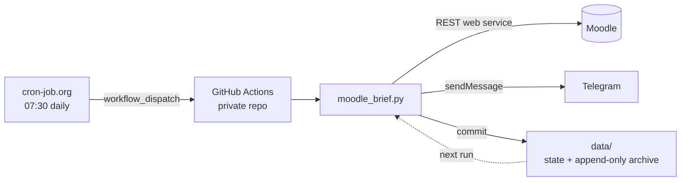

# moodle-daily-brief

[](https://github.com/kodmir/moodle-daily-brief/actions/workflows/tests.yml)


**A daily Telegram brief of everything that happened on your university's Moodle: today's deadlines,
this week's events, the next exam, and every new announcement, so you never miss a date change buried in a forum post.**

Runs for free on GitHub Actions, with no server and no laptop needed. Built for Boğaziçi University's Moodle, and
works with any Moodle site that has the mobile web service enabled.

```
☀️ 7 Kas Cumartesi

🎯 SINAVLAR                                   ← upcoming exams
• MATH201 Quiz 2 · 8 Kas Paz 10:00 (yarın)
• IE310 Ara sınav ❔ · 16 Kas Pzt 17:00 (9 gün)
   ⚠️ tarih değişti (eskisi 11 Kas)            ← a newer announcement moved the exam

📅 BU HAFTA                                   ← this week, grouped by day
Pazar 8 Kas (yarın)
  • MATH201 Ders değişikliği — Tomorrow's lecture is cancelled ❔
Pazartesi 9 Kas (2 gün)
  • EC204 Ödev — It is due November 9 at 23:59 via Moodle ❔ — 23:59
Çarşamba 11 Kas (4 gün)
  • IE310 Homework 3 — 23:59

📣 YENİ DUYURULAR (4)                         ← full text of new announcements
...
❔ = extracted from announcement text, double-check
```
<sub>Output of `python demo.py` (fictional courses). The brief is in Turkish.</sub>

## Why

Course information is scattered across Moodle: the calendar, assignment pages, forum posts,
replies under those posts, and PDFs. Exam dates are often only written in an announcement, and they get
**changed** in a later announcement. Moodle's own notifications don't summarise any of this, and they don't
tell you that "the midterm is now on the 17th, not the 11th".

## How it works



1. **Collect** everything via Moodle's web service API: course contents, files, announcements and forum
   replies, assignments, quizzes, calendar events, notifications and grades.
2. **Diff** against the previous run's state, so new and *edited* items are detected by content hash.
3. **Extract dates** from free-text announcements with a rule-based parser (Turkish and English).
4. **Merge** these with Moodle's structured dates, resolve conflicts, and render one compact brief.
5. **Send** it to Telegram and **commit** the state back to the repo, so the next run has memory.

## Interesting problems solved

**Dates in free text.** The parser handles Turkish and English (`18 Kasım`, `November 25th`, `06.11`, `2 pm`,
`yarınki quiz`, `this Friday`) and many traps:
- *"moved from Nov 11 to Nov 17"* / *"11 Kasım yerine 17 Kasım"*: only the new date counts.
- *"11/06/2026 (Friday)"*: day/month vs. month/day is resolved by checking the weekday name.
- *"Quiz 1 grades on Nov 3"*, *"midterm topics"*, *"the assignment will be announced tomorrow"*: these are
  not events.
- *"The exam will be held on Nov 17"*: the generic "exam" is refined to *midterm* from the previous
  sentence or the post title.
- Syllabus numbering (`2.1`, `Section 4.5`), version numbers and room numbers are not dates.
- When announcements disagree, the most recently posted one wins, and the brief shows ⚠️ with the old date.

**Never send a wrong brief.** Errors are classified as permanent (a disabled Moodle feature: skip that section),
transient (network, maintenance: abort without sending, retry later) or auth (bad token: notify the user once a day).
A half-fetched Moodle never produces an "all clear" message.

**Never delete anything.** Every version of every item is appended to `data/archive.jsonl`. Edited
announcements keep their previous versions. Items removed from Moodle are *hidden* (and reported), never
deleted, and only after 3 consecutive clean runs, so a temporary outage can't hide anything.

**Signal, not noise.** One upload in Moodle shows up as a module, a file and sometimes a calendar entry;
these are merged into one line. Updated items say *what* changed (`Recordings — + R8`) instead of a bare
"updated". New or changed grades get their own section, and grades that existed before tracking started
stay quiet.

**Scheduling you can trust.** GitHub's built-in cron didn't fire at all on a new repo, so an external
scheduler triggers the workflow. The script is idempotent (one brief per day, lock file, retries until noon),
so duplicate or late triggers are harmless.

**Privacy by default.** Credentials live only in GitHub Secrets and never appear in logs. The workflow
**refuses to run in a public repository**, because the bot commits your Moodle content to `data/`.

## Set up your own (about 10 minutes, free)

1. **Use this template → Create a new repository → choose _Private_.**
2. Get your **Moodle token**: Moodle → Preferences → Security keys → *Moodle mobile web service*.
3. Create a **Telegram bot** with [@BotFather](https://t.me/BotFather) and send it `/start`. To get your chat ID,
   open `https://api.telegram.org/bot<TOKEN>/getUpdates` and copy `chat.id`.
4. In your private repo: **Settings → Secrets and variables → Actions → New repository secret**,
   name it `BRIEF_SECRETS`, with the value:
   ```
   moodle_token: <your moodle token>
   telegram_bot_token: <your bot token>
   telegram_chat_id: <your chat id>
   ```
   For a Moodle site other than Boğaziçi, add a repository **variable** `MOODLE_URL`.
5. **Actions → Morning brief → Run workflow.** The brief arrives in about a minute.
6. *(Recommended)* For an exact daily time, create a free job on [cron-job.org](https://cron-job.org):
   `POST https://api.github.com/repos/<you>/<repo>/actions/workflows/brief.yml/dispatches` with the headers
   `Authorization: Bearer <fine-grained token with Actions: read & write on this repo only>`,
   `Accept: application/vnd.github+json` and the body `{"ref":"main","inputs":{"mode":"scheduled"}}`.

**Run locally instead (macOS):** `./install.sh` creates a virtualenv and a `launchd` job (every 30 min, sends
once per day after `SEND_TIME`). Configuration goes in `.env` (see `.env.example`).

## Try it without any account

```bash
pip install -r requirements.txt
python demo.py      # fake Moodle, prints the brief
pytest -q           # 65 tests: date parsing, failure modes, grades, de-duplication, no-delete guarantees
```

## iPhone version

`docs/moodle-brief.js` is a port for [Scriptable](https://scriptable.app): the same parser and rules running
entirely on the phone, with a morning notification, instant alerts for new announcements and grades, deadline
reminders that go quiet once an assignment is submitted, and a home-screen widget. Sign-in happens on Moodle's own page (SSO); the token stays in the device keychain.
Install page: https://kodmir.github.io/moodle-daily-brief/

## Optional: Claude mode

With `ANTHROPIC_API_KEY` set, PDFs, Word files and slides are read too (e.g. exam dates that appear only in a
syllabus PDF), and the brief is written by Claude. Without a key the tool is fully rule-based and costs nothing.

## Limitations

- Dates from free text are heuristics, which is why they are marked ❔ in the brief. Exact dates come from Moodle's
  own calendar, assignments and quizzes.
- In free mode, the contents of files (PDF, slides) are not read, only their names.
- Requires your Moodle site to allow the *Moodle mobile web service* (most do, because the official app uses it).
- Code comments and the brief text are in Turkish.

## Project layout

```
moodle_brief.py        collection, diffing, date extraction, rendering, Telegram, state
docs/                  install page (GitHub Pages) + the iPhone/Scriptable port
docs/version.json      Latest published version; the script checks it once a day (a test keeps it in sync)
tests/ios/             Node tests for the iPhone port (fake Moodle, fake Scriptable APIs)
demo.py                offline demo with a fake Moodle
tests/                 pytest suite (frozen clock, fake Moodle and Telegram)
.github/workflows/     brief.yml (daily run), tests.yml (CI on 3.9 and 3.12)
install.sh             local macOS setup (launchd)
```

## License

MIT © 2026 Emir Eymen Özbey
